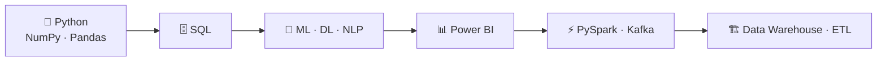

<!-- Remplace YOUR_GITHUB_USERNAME partout (Ctrl+H) -->

 

---

## 👋 À propos

> *Understand the problem → build a baseline → test → document.*

| | |
|---|---|
| 💻 | Applications web utiles et maintenables |
| 🤖 | Machine Learning, Deep Learning, NLP, Computer Vision |
| 📊 | Analyse de données, évaluation de modèles, SQL, pipelines de données |
| 🧪 | Théorie, implémentation, tests et documentation des résultats |
| 🎯 | **Objectif :** des projets reproductibles et prêts pour un portfolio |

---

## 🧰 Skills & Tools

**Front-End**

**Programming & Data**

### 🌱 Currently learning

`NumPy` · `Pandas` · `scikit-learn` · `PyTorch` · `Computer Vision` · `NLP` · `Data Engineering` · `SQL Analytics` · `PySpark` · `Kafka` · `Power BI`

Une techno passe dans « Skills » seulement quand je peux l'expliquer et l'utiliser seul.

---

## 🚀 Featured Projects

<table>
<tr>
<td width="50%" valign="top">

### 🎓 PFE Management Platform
Organiser les PFE, suivre l'avancement et centraliser l'information pour étudiants et encadrants.

`Web` · `Workflow` · `UI/UX`

[**→ Repository**](https://github.com/YOUR_GITHUB_USERNAME/REPOSITORY_NAME)

</td>
<td width="50%" valign="top">

### 🏭 Industrial Defect Detection
Détection de défauts industriels avec MAE / Vision Transformer.

`Computer Vision` · `Deep Learning` · `Evaluation`

[**→ Repository**](https://github.com/YOUR_GITHUB_USERNAME/REPOSITORY_NAME)

</td>
</tr>
<tr>
<td width="50%" valign="top">

### 🫀 ECG Anomaly Detection (GNN)
Représentations par graphes et réseaux de neurones pour détecter des anomalies ECG.

`Signal Processing` · `GNN` · `Anomaly Detection`

[**→ Repository**](https://github.com/YOUR_GITHUB_USERNAME/REPOSITORY_NAME)

</td>
<td width="50%" valign="top">

### 🏅 Olympiad 2024 Analysis
Exploration et présentation de données liées au projet Olympiad 2024.

`Data Analysis` · `Visualization` · `Web App`

[**→ Repository**](https://github.com/YOUR_GITHUB_USERNAME/REPOSITORY_NAME)

</td>
</tr>
<tr>
<td colspan="2" valign="top">

### 🚗 AutoMate — Driving School Management
Apprenants, leçons, planning et tâches administratives d'une auto-école.

`Application Development` · `Data Management` · `Automation`

[**→ Repository**](https://github.com/YOUR_GITHUB_USERNAME/REPOSITORY_NAME)

</td>
</tr>
</table>

---

## 📈 GitHub Activity

---

## 🧭 How I work

1. 🔍 Comprendre le problème avant d'écrire du code
2. 📏 Partir d'une baseline simple, puis améliorer par expériences
3. 🧪 Tester les sorties et analyser les erreurs au lieu de deviner
4. 📝 Documenter hypothèses, limites et étapes reproductibles

---

